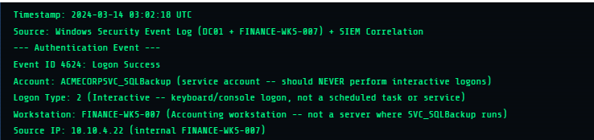
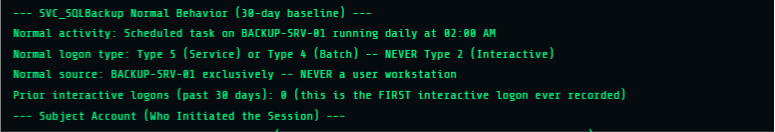

# AXIS SOC Case Study 02: Service Account Used for Interactive Logon

**Investigation ID:** AXIS-CASE-002  
**Alert Name:** Service Account Used for Interactive Login  
**Severity:** High  
**Investigation Type:** Windows Authentication / Service Account Misuse / Potential Lateral Movement  
**Investigation Platform:** AXIS Security SOC Lab  
**Primary Event:** Windows Security Event ID 4624  
**Logon Type:** 2 — Interactive  
**MITRE ATT&CK:** T1078.002 — Valid Accounts: Domain Accounts  
**Recommended Triage Decision:** Escalate  
**Investigation Status:** Completed (Simulated Case Study)

## 1. Executive Summary

This investigation examines suspicious authentication and post-login activities involving a privileged SQL backup service account within a simulated corporate Windows environment.

The alert identified a successful interactive logon involving the service account `ACMECORPSVC_SQLBackup` on an accounting workstation named `FINANCE-WKS-007`.

The account was normally used for automated SQL backup operations on `BACKUP-SRV-01` at approximately 02:00 AM. Its established behaviour involved batch or service logons, with no interactive logons recorded in the preceding 30-day baseline.

However, the observed event showed a successful interactive logon (Windows Event ID 4624, Logon Type 2) at approximately 03:02 AM on an unexpected workstation.

Following authentication, additional activities were identified, including account and privilege enumeration using `whoami /all`, Domain Admins group enumeration, an unsuccessful attempt to access the Domain Controller's administrative share, and the creation of a new scheduled task named `SQLBackupMaint`.

The combination of unusual service-account authentication, subsequent discovery activities, attempted access to another system, and scheduled-task creation raised concerns about possible service-account credential misuse and unauthorized activity.

Based on the available alert information, the activity was assessed as highly suspicious and recommended for escalation.

However, the available evidence did not independently establish the identity of the person responsible, successful Domain Controller access, malicious scheduled-task execution, or successful compromise of the environment.

## 2. Investigation Objective

The objective of this investigation was to determine whether the interactive authentication activity involving `ACMECORPSVC_SQLBackup` represented legitimate administrative activity or possible unauthorized use of a privileged service account.

The investigation aimed to:

- Examine the unusual successful authentication event.
- Understand the significance of Windows Event ID 4624 and Logon Type 2.
- Compare the observed authentication activity with the service account's normal behaviour.
- Identify the Subject and Target accounts involved in the authentication event.
- Examine subsequent account and privilege discovery activities.
- Investigate the attempted connection to the Domain Controller.
- Examine the creation of the scheduled task.
- Assess the potential security and business impact.
- Determine an appropriate SOC triage decision based on the available information.

## 3. Investigation Environment and Alert Context

The investigation was conducted using the AXIS Security SOC Lab, a simulated SOC training environment.

The platform supplied Windows Security Event Log information, SIEM correlation details, service-account baseline information, and post-authentication activity.

### 3.1 Environment Information

| Component | Details |
|---|---|
| Investigation Platform | AXIS Security SOC Lab |
| Environment | Simulated Corporate Windows Network |
| Primary Log Source | Windows Security Event Log |
| Correlated Systems | DC01 and FINANCE-WKS-007 |
| Affected Workstation | FINANCE-WKS-007 |
| Backup Server | BACKUP-SRV-01 |
| Service Account | ACMECORPSVC_SQLBackup |
| Subject Account | ACMECORPj.doe |
| Source IP Address | 10.10.4.22 |
| Related Destination | DC01 |
| Primary Event | Windows Security Event ID 4624 |
| Logon Type | 2 — Interactive |

### Evidence 01: Alert Overview



### 3.2 Normal Service Account Behaviour

According to the 30-day baseline supplied by the AXIS alert, the service account normally performed automated SQL backup operations.

Its expected behaviour was:

| Attribute | Normal Behaviour |
|---|---|
| Account | ACMECORPSVC_SQLBackup |
| Normal Workstation | BACKUP-SRV-01 |
| Primary Purpose | Automated SQL backup operations |
| Normal Schedule | Daily at approximately 02:00 AM |
| Normal Logon Types | Type 4 (Batch) or Type 5 (Service) |
| Previous Interactive Logons | 0 within the previous 30 days |

The observed interactive authentication therefore represented a deviation from the account's established behaviour.

### Evidence 02: Service Account Baseline



### 3.3 Service Account Privileges

The AXIS alert reported that the service account had the following permissions:

| System | Reported Privilege |
|---|---|
| PROD-DB-01 | SQL Server sysadmin |
| PROD-DB-02 | SQL Server sysadmin |
| BACKUP-SRV-01 | Local Administrator |
| DATABASE-SVR-01 | Local Administrator |
| Active Directory | No Domain Administrator privileges |

The account's permissions made it particularly sensitive because unauthorized use could potentially affect important production database systems.

The reported potential blast radius included full SQL Server administrative access to two production databases.

## 4. Initial Alert Analysis

The initial alert identified an unusual successful authentication event involving the SQL backup service account.

### Authentication Event Information

| Field | Observed Value |
|---|---|
| Event ID | 4624 |
| Event Description | Successful Logon |
| Target Account | ACMECORPSVC_SQLBackup |
| Logon Type | 2 — Interactive |
| Workstation | FINANCE-WKS-007 |
| Source IP | 10.10.4.22 |
| Timestamp | 2024-03-14 03:02:18 UTC |

### Why Was the Login Suspicious?

The authentication was considered suspicious because it differed from the service account's normal behaviour in three important ways.

**1. Unexpected Logon Type**

The service account normally performed automated activities using Logon Type 4 or Type 5.

However, the observed authentication used Logon Type 2, indicating an interactive logon session.

This suggested that the service account was being used for interactive computer access rather than its expected automated operations.

**2. Unexpected Time**

The account normally performed its backup operations at approximately 02:00 AM.

The suspicious interactive authentication occurred at 03:02:18 UTC.

Although the time difference alone did not prove malicious activity, it represented another deviation from the normal baseline.

**3. Unexpected Workstation**

The account normally operated on `BACKUP-SRV-01`.

However, the interactive login occurred on `FINANCE-WKS-007`, an accounting workstation.

The combination of an unexpected login type, unusual time, and unexpected workstation provided strong reasons for further investigation.

## 5. Authentication Identity Analysis

The AXIS alert identified two account fields associated with the successful authentication event.

### Subject Account

`ACMECORPj.doe`

The platform identified this as the standard IT user associated with initiating the logon activity.

### Target Account

`ACMECORPSVC_SQLBackup`

This was the service account for which the successful interactive logon session was created.

### Interpretation

The Subject and Target account distinction was important to the investigation.

The Subject account provided an account context associated with the initiation of the logon, while the Target account identified the service-account identity used for the new session.

The AXIS scenario interpreted this as the IT user entering the service account credentials interactively.

However, the Subject field alone does not establish the identity of the human physically operating the computer or independently prove how the credentials were supplied.

Additional authentication, endpoint, and process evidence would be required to establish who was responsible.

## 6. Investigation Timeline

The following timeline reconstructs the activities described in the AXIS alert.

All timestamps are reported in UTC.

| Timestamp | Observed Activity | Investigation Significance |
|---|---|---|
| 03:02:18 | Successful interactive login (Event ID 4624) | Unexpected service-account authentication |
| 03:02:33 | `whoami /all` executed | Account and privilege discovery |
| 03:03:01 | `net group "Domain Admins" /domain` | Privileged group enumeration |
| 03:03:44 | Attempted access to DC01 administrative share | Potential lateral movement |
| 03:04:07 | Scheduled task `SQLBackupMaint` created | Possible persistence activity |

The sequence showed several security-relevant actions occurring within approximately two minutes of the initial authentication event.

## 7. Post-Authentication Activity Analysis

Following the successful interactive login, the AXIS alert identified several activities that increased the security concern.

### 7.1 Account and Privilege Enumeration

At approximately 03:02:33 UTC, the session executed:

```cmd
whoami /all
```

The `whoami` command identifies the security identity associated with the current Windows session.

The `/all` parameter displays additional information, including group memberships and privileges associated with the current access token.

**Investigation significance:**

The command could help an individual understand the identity and security privileges available to the current session.

When observed shortly after an unusual service-account login, this behaviour warranted further investigation.

However, `whoami /all` is also a legitimate Windows administration and troubleshooting command. Its use alone does not establish malicious intent.

### 7.2 Domain Administrator Group Discovery

At approximately 03:03:01 UTC, the session executed:

```cmd
net group "Domain Admins" /domain
```

This command queries the membership of the Domain Admins group in the Active Directory domain.

The Domain Admins group contains highly privileged domain accounts.

**Investigation significance:**

An individual examining this group may be attempting to identify accounts with extensive administrative privileges.

This can support reconnaissance and account-discovery activities.

The observed behaviour therefore raised concerns about possible attempts to identify privileged accounts within the organisation.

However, the command itself does not grant Domain Administrator privileges or establish that privilege escalation occurred.

### 7.3 Attempted Access to the Domain Controller

At approximately 03:03:44 UTC, the alert identified an attempted connection to the administrative share on the Domain Controller, `DC01`, using the SQL backup service account.

The intended resource was described as:

```text
\\DC01\C$
```

The AXIS alert stated that the attempt was unsuccessful and associated the failure with the service account's lack of Domain Administrator rights.

**Investigation significance:**

The administrative `C$` share provides remote access to the C: drive of a Windows computer, subject to the necessary permissions.

Attempting to access this resource from another workstation represents an attempt to access a remote system.

This behaviour was concerning because it followed the service-account login and subsequent privilege-discovery activities.

It was consistent with possible lateral movement.

However, an unsuccessful administrative-share connection does not establish that the Domain Controller was compromised.

Also, the absence of Domain Administrator membership alone does not establish the exact reason access failed. The actual access-denial details were not supplied.

## 8. Scheduled Task Creation and Potential Persistence

At approximately 03:04:07 UTC, the alert identified the creation of a new scheduled task named:

```text
SQLBackupMaint
```

Scheduled tasks allow Windows to execute configured programs or scripts when specified triggers occur.

For example, a task can be configured to run:

- At a specified time.
- Daily or weekly.
- When a user logs in.
- When Windows starts.
- When a particular event occurs.

### Investigation Significance

Scheduled tasks can be used legitimately for automated system administration.

However, attackers may also abuse scheduled tasks to maintain recurring or future execution on a compromised system.

The creation of `SQLBackupMaint` shortly after unusual authentication, discovery activities, and attempted remote access therefore raised concerns about possible persistence.

### Evidence Required for Further Investigation

The available alert confirmed that the scheduled task was created, but it did not provide the full task configuration.

Further investigation would require:

- Windows Security Event ID 4698, where available, to examine task creation details.
- The account context associated with task creation.
- The scheduled task name and XML configuration.
- The executable or script configured in the task action.
- The task trigger and execution conditions.
- The configured run-as account.
- Task Scheduler operational records.
- Relevant process-creation evidence, including Event ID 4688 where available.

Without this information, the investigation could not establish whether the task was malicious or intended to maintain unauthorized access.

The task creation was therefore treated as suspicious and requiring further investigation rather than confirmed malicious persistence.

## 9. Detection Rule Analysis

The AXIS platform supplied detection-tuning guidance for identifying interactive logons involving service accounts.

### 9.1 Detection Objective

The detection aims to identify successful Windows interactive logons associated with service-account naming patterns, particularly when the logon occurs on a workstation rather than an approved server.

### 9.2 Supplied Sigma Detection Logic

The platform provided the following Sigma example:

```yaml
title: Service Account Interactive Logon

logsource:
  product: windows
  service: security

detection:
  svc_interactive:
    EventID: 4624
    LogonType: 2
    TargetUserName|startswith:
      - 'svc_'
      - 'SVC_'
      - 'sa_'
      - '_svc'

  filter_servers:
    WorkstationName|startswith: 'SRV'

  condition: svc_interactive and not filter_servers

falsepositives:
  - IT admin troubleshooting

level: high
```

### 9.3 Understanding the Detection Conditions

The detection contains two primary conditions.

**Condition 1: Service-account interactive authentication**

The rule looks for:

- Windows Event ID 4624.
- Logon Type 2.
- Target usernames matching specified service-account prefixes.

**Condition 2: Server exclusion**

The rule excludes workstation names beginning with `SRV`.

This is intended to reduce alerts from expected service-account activity on designated servers.

The overall detection logic is:

```text
Service account interactive login
              AND
Computer does not match approved server filter
              =
High-severity alert
```

### 9.4 Detection Tuning Observation

An important issue was identified when comparing the example Sigma rule with the account involved in the investigation.

The observed account was:

`ACMECORPSVC_SQLBackup`

However, the supplied rule checks usernames beginning with:

- `svc_`
- `SVC_`
- `sa_`
- `_svc`

The observed account does not begin with any of these prefixes.

Therefore, the supplied example rule, interpreted literally, would not match this particular account name.

The organisation would need to adjust its service-account naming patterns or introduce additional account-identification conditions.

The alert also stated that the service-account login occurred on `FINANCE-WKS-007`, which would not match the supplied `SRV` server-name exclusion.

This highlights the importance of ensuring that detection rules accurately reflect the organisation's actual account-naming conventions and environment.

The example Sigma rule should not automatically be assumed to be the exact implementation of the detection that generated the AXIS alert.

## 10. False-Positive Considerations

The AXIS platform identified possible legitimate explanations for service-account interactive logons.

Examples included:

- An IT administrator using a service account for troubleshooting.
- Misconfigured automation.
- Administrative activities performed outside normal operational procedures.

The platform supplied estimated false-positive rates of approximately:

- 8% for service-account interactive logons.
- 2% for interactive service-account logons around 03:00 AM on a workstation.

These are platform-provided estimates, not independently verified industry-wide statistics.

### Contextual Assessment

Although legitimate explanations were possible, several factors increased the concern in this case:

1. The account had no interactive logons in the previous 30-day baseline.
2. The login occurred on an unexpected workstation.
3. The authentication occurred outside its normal backup schedule.
4. Account and privilege discovery followed the login.
5. An attempt was made to access the Domain Controller.
6. A new scheduled task was subsequently created.

The combination of these activities made an immediate false-positive classification inappropriate.

## 11. MITRE ATT&CK Mapping

The AXIS alert supplied the following MITRE ATT&CK mapping:

| Technique ID | Technique Name | Relevance |
|---|---|---|
| T1078.002 | Valid Accounts: Domain Accounts | Use of a valid domain service-account identity for authentication |

The observed behaviour was consistent with possible misuse of a legitimate account.

The presence of a valid account does not automatically establish that its use was malicious. The surrounding authentication context and post-login activities were important to the assessment.

The other observed behaviours, including account discovery, attempted administrative-share access, and scheduled-task creation, also provided areas for additional MITRE ATT&CK investigation.

## 12. Business Impact and Security Risk

The SQL backup service account had significant permissions within the simulated organisation.

Its reported access included SQL Server sysadmin privileges on two production databases and local administrator privileges on two servers.

Unauthorized use could potentially create risks involving:

### Confidentiality

An individual with unauthorized access to the production databases could potentially access sensitive organisational or customer information, depending on database permissions and controls.

### Integrity

Unauthorized use of SQL Server administrative privileges could potentially result in changes to database records, configurations, or other critical resources.

### Availability

Misuse of administrative privileges could potentially disrupt database operations, backup processes, or other important services.

### Lateral Movement

Access to multiple systems could potentially provide opportunities for further unauthorized activity.

The actual impact of the incident was not established by the available alert information.

## 13. Recommended SOC Response

Based on the observed authentication and post-login activities, the following actions would be recommended for a real-world environment:

1. Escalate the alert to the incident-response or security investigation team.
2. Validate the legitimacy of the interactive service-account login.
3. Contact the account owner or responsible IT administrator to verify the activity.
4. Review approved maintenance requests and change-management records.
5. Investigate the source workstation, `FINANCE-WKS-007`.
6. Examine authentication records and determine whether the service-account credentials may have been exposed or shared.
7. Investigate the attempted connection to `DC01` and establish the exact reason access failed.
8. Examine the scheduled task `SQLBackupMaint`, including its creator, executable, trigger, configuration, and run-as account.
9. Review process-creation and Task Scheduler records around the incident timeline.
10. Assess the service account's permissions on both production databases and associated servers.
11. Consider disabling or restricting the service account if unauthorized use is established and operationally safe to do so.
12. Rotate the service-account credentials if compromise is suspected or confirmed.
13. Review other systems for similar authentication or scheduled-task activity.
14. Continue monitoring for further suspicious activity involving the service account.

Any containment action involving the backup service account should be coordinated with the responsible IT team to avoid disrupting legitimate backup operations.

## 14. Investigation Limitations

This case study was based on the simulated alert information and investigation details supplied by the AXIS Security SOC Lab.

The following limitations were identified:

- The original Windows Security event XML was not independently exported or examined during this exercise.
- The full underlying SIEM alert payload was not preserved as a separate evidence file.
- The identity of the human physically responsible for the interactive login was not independently established.
- The actual reason for the failed Domain Controller access was not independently verified.
- The scheduled task's complete configuration was not provided.
- The executable or script associated with the scheduled task was not identified.
- Successful execution of the scheduled task was not established.
- The full impact on the production databases was not established.
- The activity did not independently establish successful Domain Controller compromise.

### Data Consistency Note

The AXIS alert reported that the service-account password was last changed on 2021-08-10 and had an age of 847 days.

However, those two values do not appear consistent with the reported investigation date of 2024-03-14.

The password-age figure should therefore be independently verified before being used as a confirmed finding.

These limitations were documented to ensure that the investigation conclusions remained consistent with the available information.

## 15. Final Investigation Assessment

**Final Recommended Classification: HIGH-SEVERITY SUSPICIOUS ACTIVITY — ESCALATE**

The investigation identified a successful interactive logon involving a privileged SQL backup service account on an unexpected accounting workstation.

The account's normal behaviour involved automated SQL backup operations on `BACKUP-SRV-01`. However, the observed activity involved a Type 2 interactive logon outside the established operational pattern.

Subsequent activities included account and privilege enumeration, an unsuccessful attempt to access the Domain Controller's administrative share, and the creation of a new scheduled task.

The combination of these activities raised substantial concerns about possible service-account credential misuse, unauthorized access, attempted lateral movement, and potential persistence.

The account's extensive privileges on two production databases further increased the potential business impact.

Based on the available information, escalation was the appropriate recommended SOC triage decision.

However, the investigation did not establish the identity of the person responsible, successful Domain Controller access, malicious scheduled-task execution, or successful compromise of the organisation's systems.

Further investigation and endpoint evidence would be required to establish the full scope and impact of the incident.

## 16. Lessons Learned

This investigation demonstrated several important SOC investigation principles.

1. A successful authentication event does not automatically represent legitimate activity.
2. Service-account usage should be evaluated against its expected purpose and normal behaviour.
3. Windows Event ID 4624 records successful logons, while the Logon Type provides additional authentication context.
4. Logon Type 2 represents an interactive logon.
5. The Subject and Target account fields represent different aspects of an authentication event.
6. A Subject account recorded in an event does not automatically establish the identity of the human operating the computer.
7. Commands such as `whoami /all` and `net group` can help identify account and privilege information.
8. Administrative-share access attempts can indicate possible lateral movement.
9. Scheduled-task creation warrants investigation but does not independently prove malicious persistence.
10. Account names, timestamps, workstations, process information, and logon-session identifiers should be correlated when investigating suspicious activity.
11. Legitimate explanations should be validated against approved activities and supporting evidence.
12. Detection rules must reflect the actual naming conventions and operational environment.
13. Suspicious behaviour should not be classified as confirmed compromise without supporting evidence.
14. Investigation limitations must be documented rather than replaced with assumptions.

## 17. Disclaimer

This case study was completed using the AXIS Security SOC Lab, a simulated SOC investigation environment.

The report documents the alert information, investigation reasoning, technical concepts, and recommended SOC response.

It does not represent an independently confirmed real-world security incident or a direct forensic examination of the underlying Windows event logs.

All conclusions are limited to the information supplied by the simulated investigation scenario.
