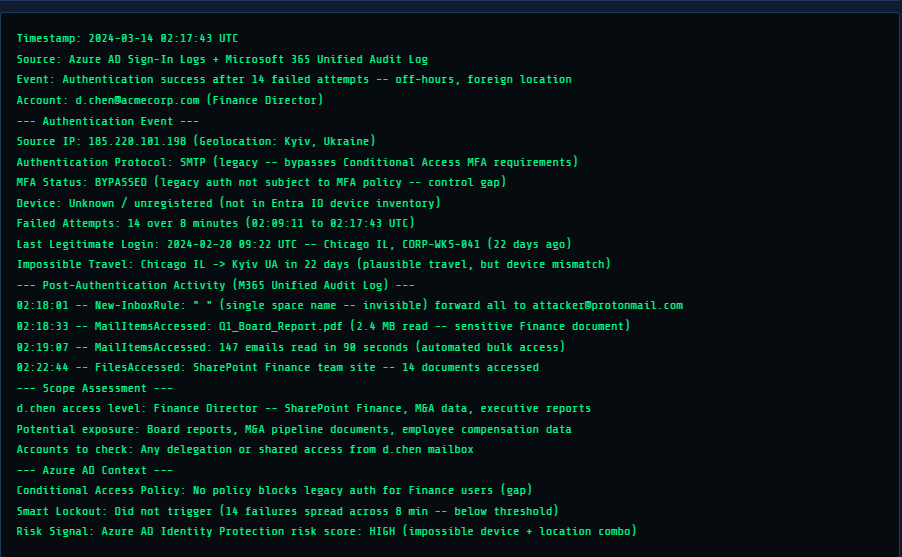
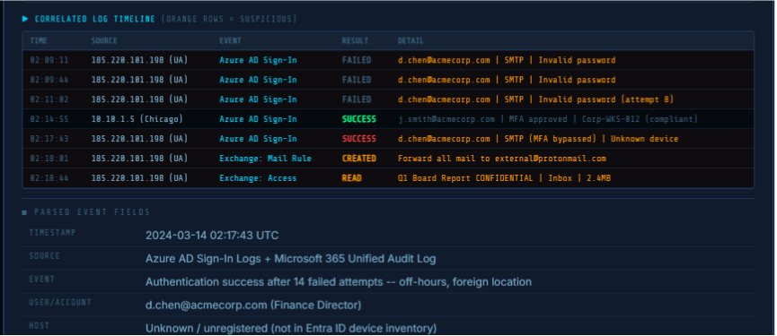
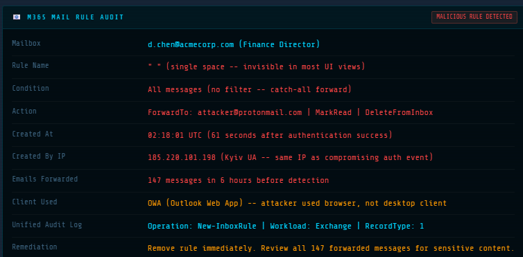

# Investigation 01: Suspected Account Compromise and Malicious Email Forwarding

## 1. Case Overview

| Field | Details |
|---|---|
| Case ID | SOC-001 |
| Investigation Type | Identity Security / Account Compromise |
| Severity | High — as assigned by the lab |
| Environment | Axis Security SOC Lab |
| Investigation Status | Lab investigation completed; real-world remediation not performed |
| Alert | Multiple Failed Logins Followed by Success: Off-Hours |
| MITRE ATT&CK | T1110.001 — Password Guessing |

**Important:** This is a simulated SOC investigation. The findings describe evidence presented by the training lab, not a confirmed incident affecting a real organization.

## 2. Executive Summary

A high-severity identity alert indicated multiple failed authentication attempts followed by a successful login outside normal working hours. Further simulated evidence associated the login with legacy SMTP authentication, a suspicious source IP address, a malicious mailbox forwarding rule, and access to confidential information.

The combination of authentication anomalies and subsequent mailbox activity strongly suggested possible account compromise and email data exposure. The available evidence did not establish the full scope of compromise or prove that an endpoint or other account was compromised.

## 3. Alert Details

The alert reported repeated failed logins followed by a successful authentication for `d.chen@acmecorp.com`.

Key details presented by the lab included:

- **Failed authentication attempts:** 14 before a successful login.
- **Successful login time:** 2024-03-14 at 02:17:43 UTC.
- **Authentication method:** Legacy SMTP.
- **Source IP:** `185.220.101.198`.
- **Source location shown:** Kyiv, Ukraine.
- **Security concern:** The lab indicated that the legacy authentication path was not covered by the MFA policy.

The source IP and geographic location were suspicious in the context of the other evidence, but location alone is not proof of malicious activity.

## 4. Evidence Collected

### 4.1 Authentication Activity

The lab presented 14 failed login attempts followed by a successful login. The successful authentication occurred using legacy SMTP, with the lab indicating that MFA was bypassed because the authentication path was not covered by policy.

**Assessment:** This pattern is consistent with possible password guessing followed by unauthorized access. The evidence does not independently establish who performed the login or how the credentials were obtained.

### 4.2 Malicious Mailbox Forwarding Rule

The lab showed a mailbox rule with the following characteristics:

- The rule used a single-space name, making it difficult to notice.
- It applied to all messages.
- It forwarded messages to `attacker@protonmail.com`.
- It marked messages as read and deleted them from the inbox.
- The rule was created through Outlook Web Access from the same source IP.

**Assessment:** The rule's behavior was consistent with an attempt to maintain access to email and conceal the forwarding activity.

### 4.3 Email and File Access

Additional lab evidence indicated:

- 147 emails forwarded within six hours before detection.
- Access to a confidential Q1 Board Report, shown as 2.4 MB.
- Other evidence indicating rapid email access and access to 14 SharePoint Finance documents.

**Assessment:** These findings raise concern about potential exposure of confidential information. The actual contents of all forwarded emails and accessed files were not independently reviewed during this investigation, so the precise impact remains undetermined.

## 5. Investigation Timeline

All timestamps below are from the simulated lab evidence.

| Time (UTC) | Event |
|---|---|
| 02:17:43 | Successful legacy SMTP authentication following 14 failed attempts |
| 02:18:01 | Suspicious mailbox forwarding rule created |
| 02:18:44 | Confidential Q1 Board Report shown as accessed |
| Subsequent six-hour period | Lab evidence reported 147 forwarded emails before detection |

The timeline suggests that suspicious mailbox activity followed closely after the successful authentication. It supports a potential relationship between the events, but does not independently prove the identity or intent of the actor.

## 6. Findings and Assessment

**Finding 1 — Suspicious authentication:** Repeated failures followed by a successful legacy authentication warrant investigation for possible credential compromise.

**Finding 2 — Malicious mailbox rule:** Automatic forwarding to an external address, combined with marking and deleting messages, is consistent with mailbox abuse and possible concealment.

**Finding 3 — Potential data exposure:** The reported forwarding volume and access to confidential email and SharePoint material indicate a risk of unauthorized information disclosure.

**Finding 4 — Incomplete scope:** The available evidence did not establish whether other accounts or endpoints were affected, whether credentials were stolen by a particular method, or whether lateral movement occurred.

### Overall Assessment

The simulated incident is **highly suspicious for account compromise with potential email data exposure**. The available evidence supports escalation and containment priorities, but does not establish the complete scope or final business impact.

## 7. Recommended Incident Response Actions

The following are recommendations, not actions confirmed to have been performed on a real system.

### Immediate containment

1. Confirm the affected account is contained and disable or restrict it according to the organization's incident-response procedure.
2. Revoke active sessions and refresh tokens where supported.
3. Remove the malicious mailbox forwarding rule after preserving relevant evidence.
4. Reset credentials and review authentication methods as appropriate.

### Investigation and scoping

5. Review sent items, deleted items, mailbox audit logs, and message trace data to identify forwarded messages and potential recipients.
6. Review identity audit logs for authentication-method changes, suspicious sessions, and related sign-ins.
7. Investigate access to the reported SharePoint documents and other sensitive resources.
8. Search identity and endpoint telemetry for related activity, including suspicious logons, remote access, and possible lateral movement.
9. Preserve relevant logs and document the timeline, affected resources, decisions, and evidence sources.

### Prevention

10. Assess whether legacy authentication can be blocked or restricted through appropriate identity policies, with testing and business-impact review before enforcement.
11. Verify that MFA requirements cover all supported authentication paths.
12. Review alerting for suspicious mailbox rules, external forwarding, and repeated authentication failures.

## 8. Limitations

- This was a simulated training environment, not a live enterprise incident.
- The report is based on evidence displayed by the lab; raw production logs were not available.
- The contents of all forwarded messages and accessed documents were not independently inspected.
- Full endpoint scope, related account activity, and lateral movement were not established.
- Some profile and historical-login details shown by the lab were inconsistent. Those details were therefore not used to make definitive conclusions.
- No real account was disabled, session revoked, forwarding rule removed, or identity policy changed as part of this case study.

## 9. Lessons Learned

- A successful login does not automatically mean an account is safe, especially after repeated failures.
- Legacy authentication can create security gaps when it is not covered by the expected MFA controls.
- Mailbox forwarding rules can be abused to collect messages and conceal activity.
- A sound investigation separates observed evidence from assumptions and identifies what remains unknown.
- Containment, evidence preservation, and scope assessment should be coordinated according to incident severity and organizational procedures.

## 10. Conclusion

The lab evidence supported escalation of a suspected account compromise involving suspicious authentication, a malicious mailbox rule, and potential email data exposure. The recommended next steps focus on containment, determining the extent of exposure, checking for related activity, and reducing the risk of recurrence.

This case study demonstrates a structured, evidence-based approach to SOC alert triage and incident investigation.

## 11. Supporting Evidence

The following screenshots were captured from the simulated SOC investigation and support the findings documented above.

### Evidence 1: Alert Summary

### Evidence 2: Authentication Activity

### Evidence 3: Malicious Mailbox Forwarding Rule

