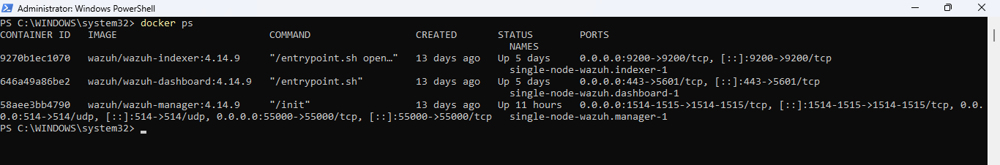
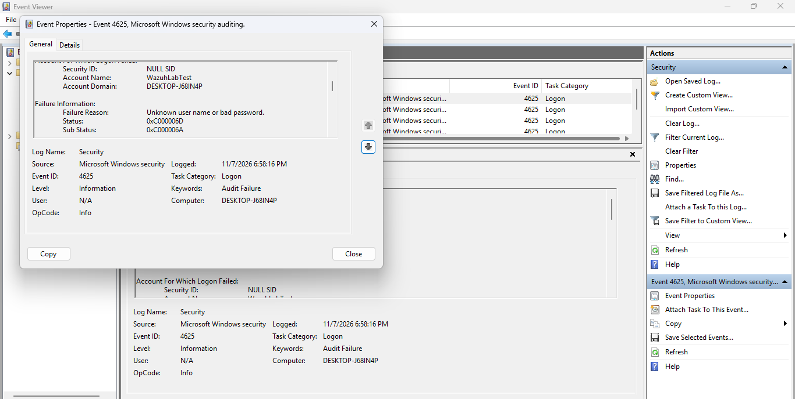
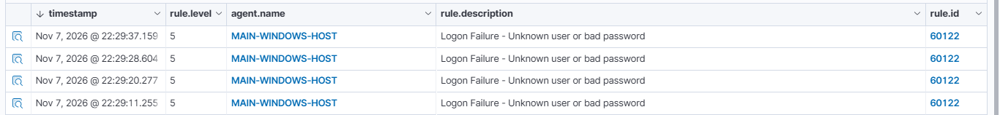
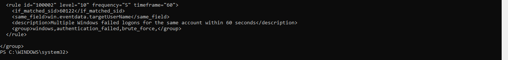
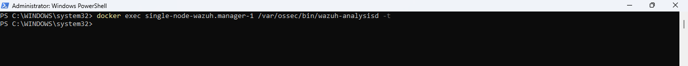
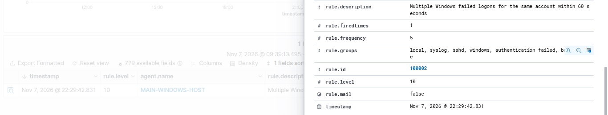
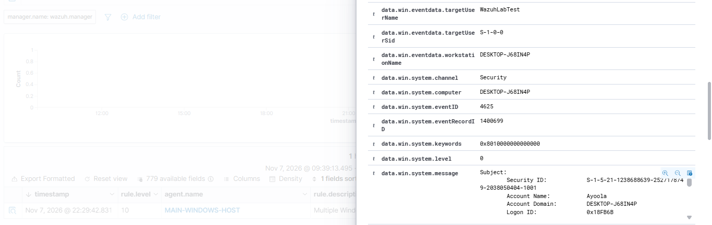

# Windows Failed Logon Correlation and Custom Brute-Force Detection Using Wazuh
## Project Overview

This project focuses on investigating repeated failed login attempts on a Windows 11 system using Wazuh SIEM.

A test user account was created, and multiple incorrect password attempts were deliberately generated to produce Windows Security Event ID 4625 (Failed Logon).

The events were monitored and analysed in Wazuh. A custom detection rule was then developed to identify five failed logon attempts involving the same target account within 60 seconds.

The objective was to demonstrate how a SOC analyst can investigate authentication failures, correlate related security events, and develop custom detection rules to identify potentially suspicious login activity.
## Objectives

The objectives of this practical were to:

1. Investigate Windows failed logon events (Event ID 4625) using Windows Event Viewer.
2. Monitor and analyse failed authentication events using Wazuh SIEM.
3. Examine existing Wazuh detection rules and understand their correlation logic.
4. Develop a custom Wazuh rule to detect repeated failed logon attempts against the same account.
5. Configure the rule to trigger after five failed attempts within 60 seconds.
6. Validate the custom rule and test its detection capability through controlled login attempts.
7. Analyse the resulting alerts and determine how event correlation can support security monitoring and investigation.
8. ## Tools and Technologies Used

The following tools and technologies were used during the investigation:

| Tool / Technology | Purpose |
|---|---|
| Windows 11 Pro | Host operating system used to generate and investigate failed logon events. |
| Wazuh SIEM (v4.14.9) | Security monitoring, event analysis, alert generation and custom rule detection. |
| Docker Desktop | Running the Wazuh manager, indexer and dashboard containers. |
| Windows Event Viewer | Examining Windows Security Event ID 4625 records. |
| PowerShell | Executing commands, managing the lab environment and interacting with Docker containers. |
| XML | Writing and configuring the custom Wazuh detection rule. |
## Lab Environment and Setup

The investigation was conducted in a controlled local laboratory environment.

The setup consisted of a Windows 11 Pro host machine running Docker Desktop, with Wazuh deployed through Docker containers.

The Wazuh deployment consisted of three main components:

| Component | Function |
|---|---|
| Wazuh Manager | Receives and analyses security events and applies detection rules. |
| Wazuh Indexer | Stores and indexes security event data for searching and analysis. |
| Wazuh Dashboard | Provides the interface for monitoring alerts and investigating security events. |

A Windows endpoint was connected to Wazuh to collect and forward Windows security events.

The test environment was configured to generate controlled failed authentication attempts, allowing the events to be monitored and investigated through the Wazuh dashboard.

All testing was performed within this isolated learning environment.
## Investigation Scenario

Repeated failed login attempts can indicate suspicious authentication activity, including password guessing and brute-force attacks.

To investigate this behaviour, a local Windows test account named `WazuhLabTest` was created. Multiple login attempts were deliberately performed using incorrect passwords through the Windows `runas` command.

Each unsuccessful attempt generated a Windows Security Event ID 4625, which was recorded in Windows Event Viewer and forwarded to Wazuh for monitoring.

The investigation focused on determining whether Wazuh could identify repeated failures against the same account within a defined time window and generate a higher-level alert through event correlation.

The test was conducted deliberately in a controlled environment. Therefore, the generated failed logons represented simulated suspicious activity, not evidence of an actual attack.
## Investigation and Analysis Process

### 1. Generating Failed Logon Events

A local Windows test account named `WazuhLabTest` was created for the investigation.

The Windows `runas` command was used to initiate login attempts against the account. Incorrect passwords were deliberately entered to generate failed authentication events.

### 2. Examining Windows Security Events

Windows Event Viewer was used to examine the generated security events.

The investigation focused on Event ID 4625, which represents a failed logon attempt.

The following event details were examined:

- Target username and domain.
- Subject username and domain.
- Logon type.
- Failure status and substatus.
- Authentication package.
- Process name.
- Source IP address.

The event showed Status `0xc000006d` and SubStatus `0xc000006a`, indicating a logon failure caused by an incorrect password.

### 3. Monitoring Events in Wazuh

The failed logon events were monitored through the Wazuh dashboard using Threat Hunting.

The built-in detection rule with ID `60122` identified the Windows failed logon events and generated individual alerts.

### 4. Examining Existing Detection Rules

The Wazuh ruleset was examined to understand how Windows authentication failures were detected.

The existing rule hierarchy was traced from Windows event decoding through the security audit failure and logon failure rules to the specific failed logon rule.

### 5. Developing a Custom Detection Rule

A custom Wazuh rule was created in `local_rules.xml` to detect repeated failed logon attempts against the same target account.

The rule was configured with the following conditions:

- Rule ID: `100002`
- Severity level: `10`
- Frequency: `5`
- Timeframe: `60 seconds`
- Matching rule: `60122`
- Correlation field: `win.eventdata.targetUserName`

The rule was designed to generate an alert when five failed logon events involving the same target account occurred within 60 seconds.

### 6. Validating and Testing the Custom Rule

The XML configuration was validated, and the Wazuh analysis engine configuration test was executed without reporting errors.

The Wazuh manager was restarted to load the updated rule.

Five controlled failed login attempts were then generated against the test account within the configured time window.

### 7. Reviewing the Detection Result

The Wazuh Threat Hunting interface was used to search for alerts generated by custom rule `100002`.

The custom alert was successfully generated after the fifth failed logon event, confirming that the correlation rule detected the simulated activity.
## Custom Detection Rule Configuration

A custom frequency-based correlation rule was created in the Wazuh `local_rules.xml` configuration file.

The purpose of the rule was to identify repeated Windows failed logon attempts involving the same target account within a 60-second period.

### Custom Rule (ID: 100002)

```xml
<rule id="100002" level="10" frequency="5" timeframe="60">
  <if_matched_sid>60122</if_matched_sid>
  <same_field>win.eventdata.targetUserName</same_field>
  <description>Multiple Windows failed logons for the same account within 60 seconds</description>
  <group>windows,authentication_failed,brute_force,</group>
</rule>
## Detection Results and Findings

The custom Wazuh detection rule was successfully tested using five controlled failed login attempts against the Windows test account `WazuhLabTest`.

The following results were observed:

1. Windows generated five failed logon events with Event ID `4625`.
2. Wazuh detected the individual events using its built-in rule `60122`.
3. The five failed logon events occurred within approximately 32 seconds.
4. The custom rule `100002` successfully correlated the events using the target username.
5. Wazuh generated a custom alert with severity level `10` after the fifth matching event.

### Detection Summary

| Parameter | Observed Result |
|---|---|
| Target account | WazuhLabTest |
| Windows Event ID | 4625 |
| Built-in Wazuh Rule | 60122 |
| Custom Wazuh Rule | 100002 |
| Number of failed attempts | 5 |
| Correlation timeframe | Approximately 32 seconds |
| Configured timeframe | 60 seconds |
| Custom alert level | 10 |
| Detection status | Successful |

The results confirmed that the custom correlation rule worked as intended and successfully identified repeated failed logon attempts against the same account within the configured timeframe.

However, the alert alone does not establish that a real brute-force attack occurred. The activity was deliberately generated as part of a controlled laboratory simulation.
## Evidence and Screenshots

The following screenshots provide supporting evidence of the laboratory setup, Windows security events, Wazuh configuration and successful detection.

### 1. Lab Environment

Shows the Wazuh Docker containers running in the laboratory environment.



### 2. Windows Failed Logon Event

Shows the Windows Security Event ID 4625 generated during the controlled failed login attempt.



### 3. Individual Failed Logon Alerts

Shows the individual failed logon events detected by Wazuh using built-in rule 60122.



### 4. Custom Wazuh Detection Rule

Shows the custom XML correlation rule (ID 100002) configured in local_rules.xml.



### 5. Configuration Validation

Shows the Wazuh analysis engine configuration test performed after creating the custom rule.



### 6. Custom Detection Alert

Shows the alert generated by Wazuh after detecting five failed logon attempts within the configured timeframe.





### 7. Failed Logon Correlation

Shows the timestamps of the five individual failed logon events used to confirm that they occurred within the 60-second correlation window.


## Investigation Conclusion

The investigation successfully demonstrated how Wazuh SIEM can be used to monitor Windows authentication failures and detect repeated failed logon attempts through custom event correlation.

During the practical, Windows Security Event ID 4625 records were generated through controlled login attempts and successfully detected by Wazuh using its built-in authentication failure rule.

A custom frequency-based detection rule was developed and tested. The rule successfully generated a level 10 alert after five failed logon attempts against the same target account occurred within 60 seconds.

This practical strengthened my understanding of Windows security event analysis, SIEM alert monitoring, custom detection engineering and event correlation.

It also demonstrated how security analysts can extend existing SIEM detection capabilities to identify potentially suspicious authentication patterns.

The activity was a controlled laboratory simulation and should not be interpreted as evidence of an actual security breach.
## Skills Demonstrated

This practical provided hands-on experience in the following areas:

- **Windows Security Event Analysis:** Investigating Windows Security Event ID 4625 and interpreting authentication failure details.
- **SIEM Monitoring:** Using Wazuh to monitor, search and investigate security alerts.
- **Log Analysis:** Examining authentication events, timestamps, usernames, logon types and failure codes.
- **Detection Engineering:** Developing and configuring custom Wazuh detection rules using XML.
- **Event Correlation:** Applying frequency-based correlation to identify repeated failed logon attempts.
- **Rule Validation:** Testing Wazuh configuration and confirming that custom detection logic works as expected.
- **PowerShell and Docker:** Managing the laboratory environment and interacting with Wazuh containers.
- **Security Investigation:** Analysing alert evidence and distinguishing controlled simulations from confirmed security incidents.


