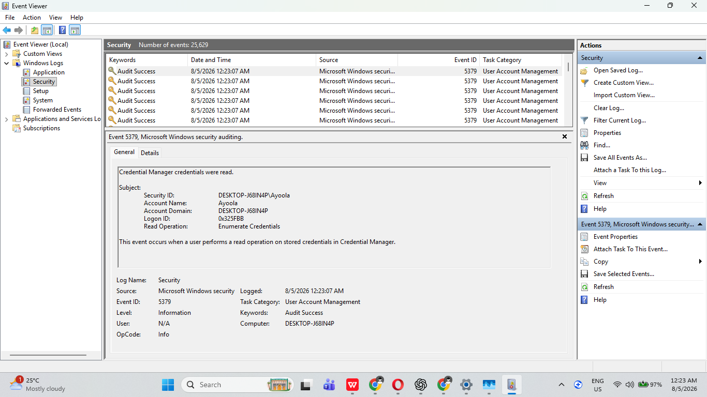
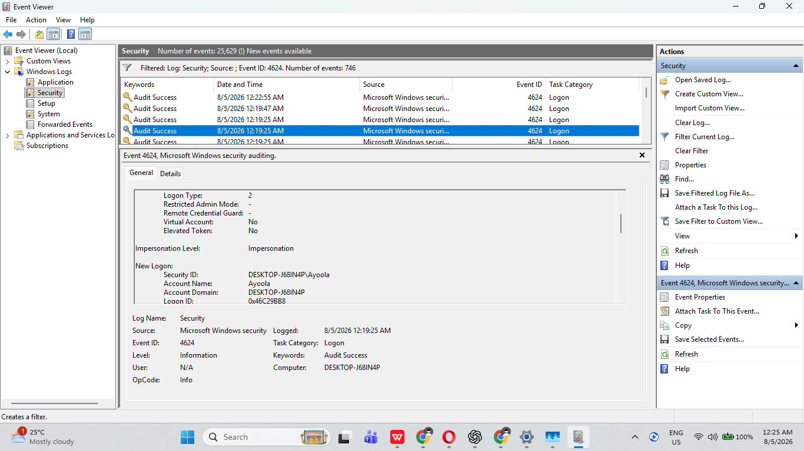
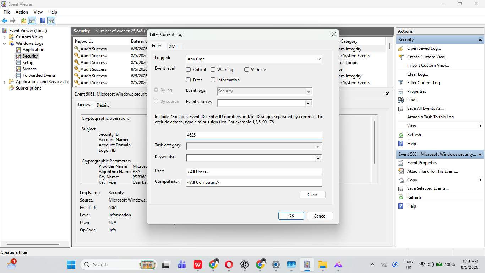
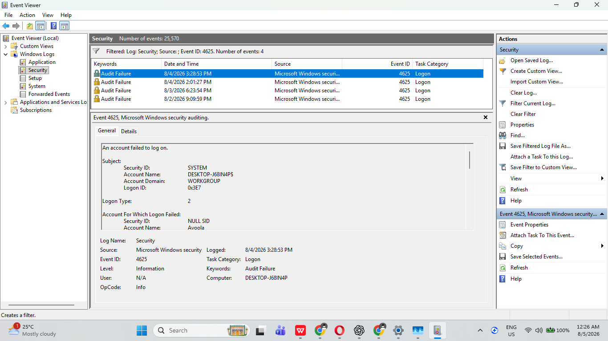

# SOC Investigation 001: Windows Authentication Investigation
**Windows Authentication Analysis Using Event Viewer (Event IDs 4624 and 4625)**

## 1. Project Overview

This investigation focuses on analyzing Windows Security logs to examine successful and failed authentication activities using Windows Event Viewer.

The investigation examines Event ID **4624** (successful logon) and Event ID **4625** (failed logon) to understand user authentication behaviour and determine whether the observed login activities appear legitimate or potentially suspicious.

The practical demonstrates how a SOC analyst can use native Windows security tools to investigate authentication events, review relevant event details, and make evidence-based security assessments.

## 2. Objectives

The objectives of this investigation were to:

- Examine successful and failed Windows authentication events.
- Identify relevant information contained in Event IDs 4624 and 4625.
- Review usernames, timestamps, logon types, and authentication failure reasons.
- Determine whether the observed authentication activities appeared legitimate or suspicious.
- Understand how Windows Security logs support security monitoring and incident investigation.

## 3. Tools and Technologies Used

- **Operating System:** Windows
- **Log Analysis Tool:** Windows Event Viewer
- **Log Source:** Windows Security Logs
- **Event IDs:** 4624 and 4625

## 4. Investigation Scope

The investigation was conducted on a Windows workstation.

The analysis focused on two Windows Security event types:

| Event ID | Description |
|---|---|
| 4624 | Successful logon |
| 4625 | Failed logon |

The purpose was to examine the authentication activities recorded in the Security log and assess whether they indicated normal user behaviour or possible unauthorized access.

## 5. Investigation Process

The following steps were performed:

1. Opened Windows Event Viewer.
2. Navigated to **Windows Logs → Security**.
3. Filtered the Security log for Event ID 4624 to identify successful logon activities.
4. Reviewed the successful authentication event and its details.
5. Filtered the Security log for Event ID 4625 to identify failed logon activities.
6. Examined the failed authentication event and its recorded failure reason.
7. Compared the account names, timestamps, logon types, and other available event details.
8. Assessed the observed activities to determine whether they appeared suspicious.

## 6. Findings and Analysis

### 6.1 Successful Authentication – Event ID 4624

A successful authentication event was identified for the user account **Ayoola**.

The event recorded **Logon Type 2**, which represents an interactive logon, typically involving a user signing in directly at the workstation.

This activity was consistent with a user accessing the Windows workstation locally.

### 6.2 Failed Authentication – Event ID 4625

A failed authentication event was also identified for the same user account, **Ayoola**.

The event recorded the failure reason:

**Unknown username or bad password.**

The event also recorded **Logon Type 2**, indicating an interactive logon attempt.

Based on the available event details, the failed authentication appeared consistent with an incorrect password entry rather than clear evidence of malicious activity.

### 6.3 Overall Analysis

The successful and failed authentication events involved the same user account and the same logon type.

The available evidence did not establish a pattern of repeated failed authentication attempts or other clear indicators of unauthorized access.

The observed activity was therefore assessed as likely normal user authentication behaviour.

## 7. Evidence Collected

The following screenshots were collected during the investigation to support the analysis and document the authentication activities observed.

### Evidence 1: Windows Security Log

### Evidence 2: Event ID 4624 Filter

### Evidence 3: Successful Authentication Event

### Evidence 4: Event ID 4625 Filter

### Evidence 5: Failed Authentication Event

## 8. Investigation Conclusion

The investigation successfully demonstrated how Windows Event Viewer can be used to examine authentication activities through Windows Security logs.

Event IDs 4624 and 4625 provided useful information about successful and failed login attempts, including the affected account, logon type, and authentication failure reason.

Based on the available evidence, no clear indicators of malicious authentication activity were identified during this investigation.

However, a single successful or failed authentication event cannot independently establish whether an account is compromised. Further investigation, including reviewing authentication patterns, timestamps, source addresses, and related security events, would be necessary if additional suspicious activity were discovered.

## 9. Skills Demonstrated

- Windows Event Viewer navigation and log analysis.
- Windows Security event investigation.
- Identification and interpretation of Event IDs 4624 and 4625.
- Authentication monitoring and analysis.
- Examination of logon types and failure reasons.
- Evidence collection and documentation.
- Basic security incident assessment.
- Evidence-based security reporting.

## 10. Disclaimer

This investigation was conducted in a controlled learning environment for educational and cybersecurity skill-development purposes.

The findings represent an analysis of the available Windows Security log evidence and should not be interpreted as a complete security audit of the workstation.
