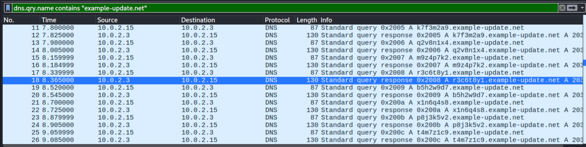
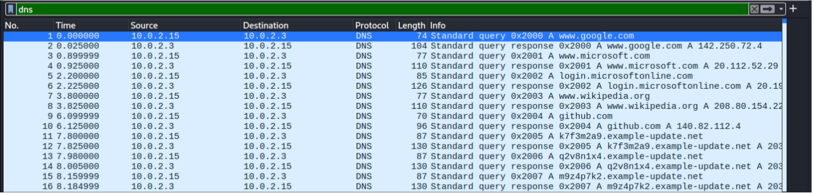
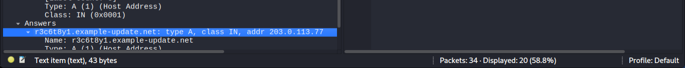

# Investigation 05: Suspicious DNS Activity Investigation

**Investigation Type:** DNS Traffic Analysis / Suspicious DNS Activity  
**Environment:** Controlled Cybersecurity Laboratory  
**Primary Analysis Tool:** Wireshark  
**Evidence Source:** Network Packet Capture (PCAP)  
**Status:** Completed

## 1. Project Overview

This investigation examines unusual DNS query activity identified through network packet analysis using Wireshark.

The investigation focuses on a pattern of random-looking subdomain queries occurring at very short intervals, with multiple queries resolving to the same destination IP address.

The objective was to determine whether the observed DNS behaviour was consistent with normal domain resolution or potentially suspicious automated activity requiring further investigation.

The investigation demonstrates how a SOC analyst can examine DNS traffic, identify unusual query patterns, correlate DNS responses, and make evidence-based security assessments.

## 2. Investigation Objectives

The objectives of this investigation were to:

- Examine DNS traffic using Wireshark.
- Identify unusual or random-looking DNS subdomain queries.
- Analyse the frequency and timing of DNS requests.
- Examine DNS responses and destination IP addresses.
- Determine whether the observed query pattern was consistent with automated DNS activity.
- Assess potential security implications of the observed behaviour.
- Establish an appropriate classification based on the available network evidence.

## 3. Investigation Environment

The investigation was conducted using a network packet capture containing DNS traffic.

### Network Information

| Component | Observed Value |
|---|---|
| Source IP Address | `10.0.2.15` |
| DNS Server | `10.0.2.3` |
| Resolved Destination IP | `203.0.113.77` |
| Protocol | DNS |
| Primary Analysis Tool | Wireshark |

The packet capture was used to examine DNS queries, responses, domain names, timestamps, and resolved IP addresses.

## 4. Investigation Scenario

A SOC analyst observes unusual DNS activity originating from a workstation.

The workstation generates multiple DNS queries containing random-looking subdomains within a short period. Several of the queried subdomains resolve to the same destination IP address.

The analyst is required to investigate the DNS traffic and determine whether the observed behaviour represents normal domain resolution or a potentially suspicious automated communication pattern.

The investigation focuses on identifying observable network behaviour without assuming malicious intent before examining the available evidence.

## 5. Observed DNS Activity

The initial examination of the PCAP revealed the following observations:

1. The workstation with source IP `10.0.2.15` generated multiple DNS queries.
2. The DNS queries were directed to DNS server `10.0.2.3`.
3. Approximately 20 suspicious DNS queries were identified.
4. The queries contained random-looking subdomain names.
5. The queries occurred at very short intervals.
6. Different subdomains were observed resolving to the same destination IP address, `203.0.113.77`.

The combination of unusual query names, high query frequency, and repeated resolution patterns required further investigation.

## 6. DNS Query Timing and Pattern Analysis

The observed DNS queries occurred between approximately 7.80 and 9.44 seconds in the packet capture timeline.

Approximately 20 queries were identified within this short period.

The queries occurred at intervals of roughly 0.18 seconds.

This repeated pattern suggests that the DNS requests were generated automatically rather than through ordinary manual browsing activity.

However, automated DNS activity can also result from legitimate applications, background services, monitoring systems, or other software.

Further analysis is therefore required before attributing malicious intent to the activity.

## 7. Evidence Collection and Analysis

The investigation was supported by Wireshark packet analysis and the original PCAP file.

### Evidence 1: Random-Looking DNS Domain Names

The following screenshot shows the unusual DNS subdomain names observed during the investigation.

**Analysis:**

The observed subdomains contained random-looking character sequences.

Such domain patterns can be associated with automated DNS activity and may be observed in certain malware communication techniques, including DNS tunnelling.

However, random-looking subdomains alone do not establish that DNS tunnelling or malicious communication occurred.

### Evidence 2: DNS Packet Details

The following screenshot shows the DNS packet activity captured during the investigation.

**Analysis:**

The packet information provides evidence of repeated DNS requests occurring within a short period.

Approximately 20 suspicious queries were identified between 7.80 and 9.44 seconds in the capture timeline.

The frequency and sequence of these requests suggest automated DNS query generation.

### Evidence 3: Repeated Destination IP Address

The following screenshot shows different DNS subdomains resolving to the same destination IP address.

**Analysis:**

The observed DNS responses showed that multiple queried subdomains resolved to the same destination IP address, `203.0.113.77`.

This repeated resolution pattern provides additional context for the investigation.

However, multiple domain names resolving to one IP address can also occur in legitimate DNS configurations, including shared hosting and content delivery infrastructure.

The observation must therefore be assessed alongside the unusual query names and frequency.

## 8. Key Investigation Findings

The investigation identified the following findings:

1. The workstation `10.0.2.15` generated approximately 20 suspicious DNS queries.
2. The DNS requests were directed to server `10.0.2.3`.
3. The queries contained random-looking subdomain names.
4. The queries occurred between approximately 7.80 and 9.44 seconds in the packet capture timeline.
5. The requests occurred at intervals of roughly 0.18 seconds.
6. Different queried subdomains resolved to the same destination IP address, `203.0.113.77`.
7. The repeated and closely spaced queries were consistent with automated DNS activity.

The combination of these observations raised concerns about potentially suspicious DNS communication.

## 9. Analyst Interpretation and Security Assessment

The observed DNS traffic demonstrated a repeated pattern of unusual domain queries occurring within a short period.

The random-looking subdomains, rapid query frequency, and repeated resolution to the same destination IP address suggest that the activity may have been generated by an automated process.

Certain malware communication techniques use unusual DNS query patterns, including DNS tunnelling, to exchange information through DNS requests and responses.

However, the available evidence does not independently establish that DNS tunnelling, data exfiltration, or malware command-and-control communication occurred.

Additional investigation would be necessary to examine:

- The complete queried domain names and their structure.
- DNS query types and response details.
- Query and response sizes.
- Whether unusually large or encoded DNS records were present.
- Whether the activity continued over a longer period.
- The process or application responsible for generating the requests.
- Whether the destination address was associated with an authorized service in the laboratory scenario.

The investigation therefore treats the activity as suspicious rather than confirmed malicious communication.

## 10. Investigation Classification

**Observed Behaviour:** Unusual and Repeated DNS Query Activity

**Security Classification:** Suspicious DNS Activity — Requires Further Investigation

**Potential Threat Areas:** Automated DNS Communication, DNS Tunnelling, or Malware-Related DNS Activity

The available network evidence supports the identification of unusual DNS query behaviour.

However, the observed pattern alone does not prove DNS tunnelling, data exfiltration, or successful compromise of the workstation.

Further network and endpoint investigation would be required to establish the purpose and origin of the DNS requests.

## 11. Potential Business and Security Risks

If similar activity were identified in a production environment, potential risks could include:

- Unauthorized communication with suspicious external infrastructure.
- Potential information leakage through DNS-based communication.
- Malware command-and-control communication.
- Reduced visibility of unauthorized network activity.
- Further compromise of affected systems if malicious activity were established.

These are potential risks associated with suspicious DNS activity, not confirmed impacts of this investigation.

## 12. Recommended SOC Response

If similar activity were observed in a production environment, the following actions would be recommended:

1. Preserve the original PCAP and relevant DNS logs for further analysis.
2. Identify the process or application responsible for generating the DNS requests.
3. Examine the complete domain names and query structures.
4. Investigate the DNS query types, response sizes, and record contents.
5. Correlate the DNS timestamps with endpoint activity and process execution logs.
6. Review additional network traffic involving the identified destination.
7. Determine whether the observed domain activity is associated with an authorized application or suspicious infrastructure.
8. Investigate the affected workstation for evidence of potentially unwanted or malicious software.
9. Consider restricting communication with the destination if it is confirmed to be malicious.
10. Continue monitoring for similar DNS patterns across other systems.

## 13. Investigation Limitations

The investigation was based on the DNS traffic available in the supplied PCAP.

Although the packet capture provided evidence of unusual DNS query patterns, several aspects could not be independently established.

The investigation could not conclusively determine:

- The exact process responsible for generating the DNS requests.
- The identity of the user responsible for the activity.
- Whether the random-looking subdomains contained encoded information.
- Whether DNS tunnelling or data exfiltration actually occurred.
- Whether the destination IP address hosted malicious infrastructure.
- Whether the workstation was compromised.
- Whether the observed activity resulted in any unauthorized data transfer.

Additional endpoint telemetry, complete DNS records, and broader network analysis would be necessary to establish these details.

## 14. Investigation Conclusion

The investigation identified unusual DNS activity involving approximately 20 queries generated by workstation `10.0.2.15`.

The queries were directed to DNS server `10.0.2.3` and contained random-looking subdomain names. They occurred at intervals of approximately 0.18 seconds between 7.80 and 9.44 seconds in the packet capture timeline.

Different queried subdomains were also observed resolving to the same destination IP address, `203.0.113.77`.

The combination of unusual query names, repeated requests, and short query intervals was consistent with automated DNS activity and raised security concerns.

Based on the available evidence, the activity was classified as **Suspicious DNS Activity — Requires Further Investigation**.

However, the investigation did not establish that DNS tunnelling, data exfiltration, malware command-and-control communication, or successful system compromise occurred.

The findings demonstrate the importance of examining DNS query patterns, response behaviour, timing, and endpoint context when investigating potentially suspicious DNS activity.

## 15. Skills Demonstrated

- DNS traffic analysis using Wireshark.
- DNS query and response inspection.
- Identification of unusual domain-name patterns.
- Analysis of DNS query frequency and timing.
- Investigation of repeated DNS resolution patterns.
- Identification of potentially automated DNS activity.
- Network packet analysis and evidence collection.
- Suspicious DNS activity assessment.
- Evidence-based security classification.
- SOC investigation documentation and reporting.

## 16. Disclaimer

This investigation was conducted for educational and cybersecurity skill-development purposes using an available network packet capture.

The findings are based on the observable DNS traffic within the PCAP and should not be interpreted as proof of a confirmed malware infection, DNS tunnelling incident, or data exfiltration event.
